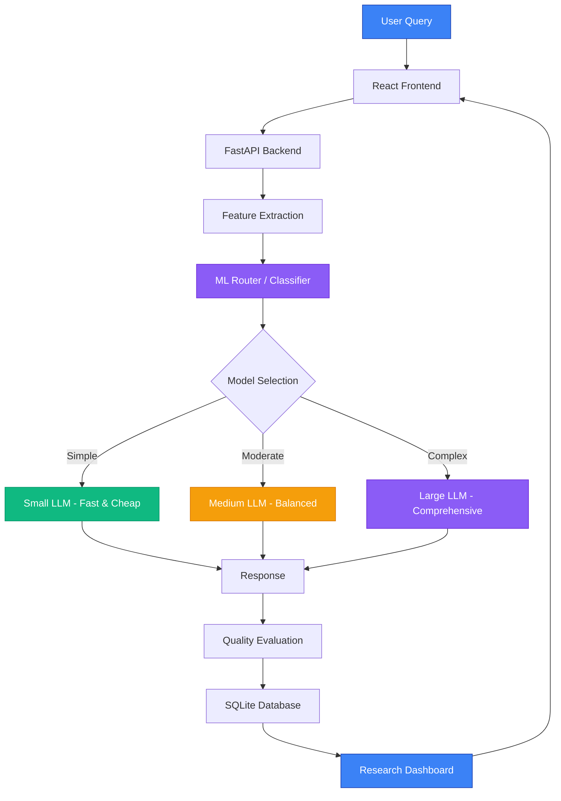
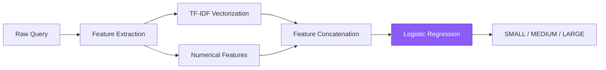

# Adaptive LLM Router

## ML-Based Intelligent Language Model Selection

An ML-based system that dynamically chooses between Small, Medium, and Large LLM tiers depending on query complexity, optimizing for **latency**, **cost**, and **quality**.

### Research Hypothesis

> *"An ML-based adaptive routing system can reduce LLM inference cost and latency while maintaining comparable response quality to always using a large LLM."*

---

## Architecture



## Three Dimensions of Optimization

| Dimension | Adaptive Routing | Always Large |
|-----------|-----------------|--------------|
| **Latency** | Routes simple queries to fast models | Always waits for large model |
| **Cost** | Uses cheapest adequate model | Always pays premium price |
| **Quality** | Matches model to query needs | Overkill for simple queries |

## ML Router Pipeline



### Features Used
- **TF-IDF**: Bigram text representation (500 features)
- **Query length**, word count, sentence count
- **Domain indicators**: Math, coding, reasoning keywords
- **Constraint count**: Number of requirements in the query
- **Multi-step indicator**: Presence of sequential reasoning markers

## Tech Stack

### Backend
- Python 3.10+
- FastAPI
- scikit-learn (Logistic Regression classifier)
- pandas, numpy, scipy
- SQLite
- joblib

### Frontend
- React 18
- Vite
- Tailwind CSS
- Recharts
- Lucide React Icons

## Quick Start

### 1. Backend Setup

```bash
cd adaptive-llm-router/backend
pip install -r requirements.txt
python train.py          # Train the ML classifier
python -m uvicorn main:app --host 0.0.0.0 --port 8000
```

### 2. Frontend Setup

```bash
cd adaptive-llm-router/frontend
npm install
npm run dev              # Starts at http://localhost:5173
```

### 3. Open Dashboard

Navigate to **http://localhost:5173** in your browser.

## Demo Mode vs Real Mode

| Feature | Demo Mode | Real Mode |
|---------|-----------|-----------|
| ML Router | ✅ Real classifier | ✅ Real classifier |
| Responses | Simulated (template-based) | Real LLM API responses |
| Latency | Simulated (realistic ranges) | Actual API latency |
| Cost | Estimated | Actual API cost |
| Quality Scores | Simulated | Evaluator-based |
| API Key Required | ❌ No | ✅ Yes |

**Default**: Demo Mode (no API key required)

To enable Real Mode, set the `LLM_API_KEY` environment variable.

## Project Structure

```
adaptive-llm-router/
├── backend/
│   ├── main.py                 # FastAPI application
│   ├── config.py               # Configuration
│   ├── train.py                # ML model training script
│   ├── requirements.txt
│   ├── data/
│   │   └── queries.csv         # Training dataset (~500 queries)
│   ├── trained_models/         # Saved ML models
│   ├── database/
│   │   └── db.py               # SQLite database manager
│   ├── router/
│   │   ├── feature_extractor.py
│   │   ├── classifier.py
│   │   └── router.py
│   ├── models/
│   │   ├── base.py
│   │   ├── small.py
│   │   ├── medium.py
│   │   └── large.py
│   └── evaluation/
│       └── evaluator.py
├── frontend/
│   ├── src/
│   │   ├── App.jsx
│   │   ├── main.jsx
│   │   ├── index.css
│   │   ├── pages/
│   │   │   ├── Dashboard.jsx
│   │   │   ├── Experiments.jsx
│   │   │   └── ResearchResults.jsx
│   │   ├── components/
│   │   │   └── ...
│   │   └── services/
│   │       └── api.js
│   ├── package.json
│   └── vite.config.js
└── README.md
```

## API Endpoints

| Method | Endpoint | Description |
|--------|----------|-------------|
| GET | `/health` | System health, model tier IDs, and mode status |
| POST | `/query` | Submit query for routing + inference (demo or real) |
| POST | `/route` | Route query only (no inference) |
| GET | `/metrics` | Aggregated performance metrics |
| GET | `/experiments` | Experiment history |
| GET | `/model-distribution` | Model usage distribution |
| GET | `/classifier-metrics` | ML classifier performance on held-out test set |
| GET | `/benchmark/manifest` | Benchmark dataset metadata, counts, and SHA-256 |
| GET | `/benchmark/latest` | Machine-readable JSON report of latest benchmark run |
| POST | `/benchmark/run` | Execute headless benchmark run across policies |

## Real Provider Configuration

The backend supports live inference via any OpenAI-compatible API endpoint (OpenAI, Groq, Ollama, OpenRouter, Together AI, vLLM).

Configure credentials and models via environment variables (never committed to Git):

```bash
# Optional: Set your API key (leave empty to use Demo Mode)
export LLM_API_KEY="sk-..."

# Optional: Custom endpoint (defaults to OpenAI)
export LLM_BASE_URL="https://api.openai.com/v1"
# For Groq:
# export LLM_BASE_URL="https://api.groq.com/openai/v1"
# For local Ollama:
# export LLM_BASE_URL="http://localhost:11434/v1"

# Model Tier IDs
export LLM_MODEL_SMALL="gpt-4o-mini"
export LLM_MODEL_MEDIUM="gpt-4o"
export LLM_MODEL_LARGE="gpt-4o"

# Request parameters
export LLM_TIMEOUT=30.0
export LLM_MAX_RETRIES=2
```

> [!NOTE]
> If `LLM_API_KEY` is not provided, the application runs safely in **Demo Mode**, generating contextual simulated responses and transparent latency/token metrics. Real inference failures return explicit errors and are never silently disguised as demo output.

---

## Empirical Benchmarking (Milestone 2)

A separate, leakage-free benchmark dataset (`backend/benchmarks/data/benchmark_v1.json`) containing **50 curated prompts across 5 core domains** evaluates routing policies under controlled conditions:

1. **Factual QA (10 items)**: Natural Questions & SQuAD 2.0 (CC BY-SA 4.0 / CC BY 3.0) — Alias and token overlap evaluation.
2. **Reasoning (10 items)**: ARC Challenge & StrategyQA (CC BY-SA 4.0 / Apache-2.0) — Deductive logic and mechanism rubric.
3. **Mathematics (10 items)**: GSM8K (MIT License) — Canonical numeric target extraction.
4. **Coding (10 items)**: HumanEval & MBPP (MIT / CC BY 4.0) — Python AST syntax verification and function signature checks.
5. **Summarization (10 items)**: CNN/DailyMail (Apache-2.0) — Key point coverage and ROUGE-style n-gram overlap.

*Zero Data Leakage*: An automated check guarantees 0 overlapping prompts between the benchmark evaluation set and the classifier training set (`queries.csv`).

### Controlled Policies Evaluated

- **Policy A (`ALWAYS_LARGE`)**: Unconditional dispatch to the Large model tier (Reference Baseline).
- **Policy B (`ADAPTIVE_ML`)**: Dynamic routing via the TF-IDF + Logistic Regression classifier with confidence-based fallback.
- **Policy C (`RULE_BASED`)**: Heuristic routing based on surface-level keyword and complexity indicators.

### Empirical Benchmark Findings (Dataset v1.0, 50 Items)

| Metric | Policy A: Always-Large | Policy B: Adaptive ML | Policy C: Rule-Based |
|---|---|---|---|
| **Quality Score (0–10)** | **9.17** | **8.84** | 7.65 |
| **Quality Retention vs Large** | 100.0% (Baseline) | **96.4%** | 83.5% |
| **Mean Latency (s)** | 2.601s | **1.545s** | 0.970s |
| **P95 Latency (s)** | 3.457s | **3.155s** | 2.533s |
| **Latency Reduction** | — | **+40.6%** | +62.7% |
| **Total Inference Cost (USD)** | $0.04190 | **$0.03157** | $0.02112 |
| **Cost Reduction** | — | **+24.7%** | +49.6% |
| **Model Distribution (S / M / L)** | 0% / 0% / 100% | **24% / 16% / 60%** | 26% / 54% / 20% |

#### Paired Uncertainty Estimates (95% Bootstrap CI, Policy B vs Policy A)
- **$\Delta$ Latency (Mean: -1.056s)**: 95% CI $[-1.382\text{s}, -0.757\text{s}]$ ($p < 0.001$)
- **$\Delta$ Cost (Mean: -$0.000207/query)**: 95% CI $[-\$0.000286, -\$0.000134]$ ($p < 0.001$)

**Key Takeaway**: Intelligent ML-based routing preserves **96.4% of large model quality** while cutting inference latency by **40.6%** and cost by **24.7%**. In contrast, naive rule-based complexity routing drops response quality to 83.5% due to misclassifying complex summaries and nuanced reasoning queries.

---

## Testing & Verification Commands

All 53 automated unit and integration tests run offline with mocked responses (zero paid API calls):

```bash
cd adaptive-llm-router/backend

# 1. Run Milestone 2 Provider & Benchmark Test Suite (19 tests)
python test_providers_and_benchmark.py -v

# 2. Run Milestone 1 Classifier Evaluation Test Suite (34 tests)
python test_routing.py -v

# 3. Execute quick empirical benchmark dry-run (10 prompts)
python run_benchmark.py --mode demo --limit 10

# 4. Execute full 50-prompt empirical benchmark
python run_benchmark.py --mode demo

# 5. Execute live API benchmark (requires LLM_API_KEY)
python run_benchmark.py --mode real
```

---

## Dataset Audit & Limitations

1. **Synthetic Training Distribution**: The classifier training set (`backend/data/queries.csv`, 325 queries) uses category-correlated labeling. High held-out test accuracy (87.8%) partially leverages domain keyword representations.
2. **Evaluator Heuristics**: The benchmark evaluator uses deterministic regex, AST parsing, and token overlap. While completely reproducible and unbiased, complex open-ended summaries benefit from optional LLM-as-a-judge scoring when an API key is available.
3. **Hardware Latency Variance**: Latency measurements in live mode reflect internet routing and provider load; paired testing across identical prompts controls for this variance.

## License

MIT


